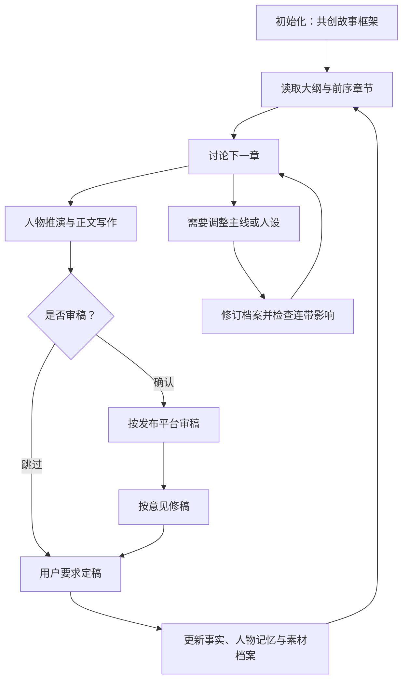
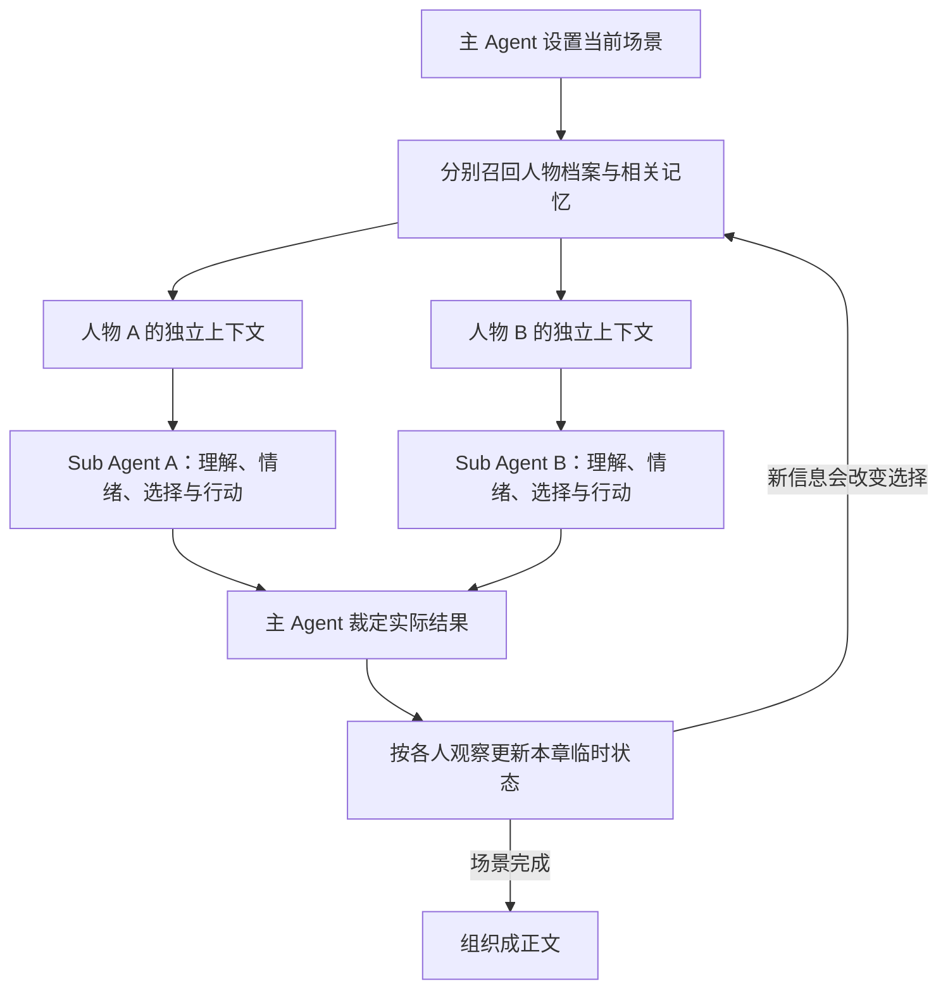

# 小说创作工作台

在 Codex 中打开这个工程，用四个 Skill 完成小说设计、续写、改设定和审稿。默认一个工程一本小说，内容与记忆保存为 Markdown。

## 快速开始

| 要做什么 | 直接对 Agent 说 |
| --- | --- |
| 初始化小说 | `使用 $novel-bootstrap，和我设计一本悬疑小说，收敛后初始化框架。` |
| 讨论下一章 | `使用 $novel-continue，读取大纲和前文，和我讨论下一章。` |
| 开始续写 | `就按这个方向写。` |
| 调整主线或人物 | `使用 $novel-revise，把主角改为外冷内热，讨论影响并更新档案。` |
| 审核章节 | `使用 $novel-review，审核刚完成的章节。` |
| 定稿并更新记忆 | `这一章定稿，同步人物记忆、关系和伏笔进度。` |



## 四个 Skill 怎么用

### 初始化：novel-bootstrap

每轮问少量问题，一起确定题材、人物、世界、核心矛盾和故事走向。信息已有就直接沿用，未定内容明确标记。

要求“先初始化一版”后，生成大纲、人物档案、关系、记忆结构、阅读期待、伏笔和第一章计划。初始化不会自动写正文。

[查看 Skill](.agents/skills/novel-bootstrap/SKILL.md)

### 续写：novel-continue

先读大纲和前序章节，直接与你讨论下一章，不让你重复介绍剧情。方向确定后，进行人物推演、写正文、做内部自检，交付草稿与待更新事项。

写完会询问是否审稿；确认后自动调用审稿 Skill。如果已明确说“写完并审稿”，则直接接着审。

草稿默认不进入正式记忆。要求定稿后才统一更新；继续写未定稿的后续章节时，前章变化作为暂定上下文。

[查看 Skill](.agents/skills/novel-continue/SKILL.md)

### 改方向：novel-revise

可以修改主线、转折、结局，也可以补充人物动机、性格、底线和成长方向。

修订会区分三种情况：补充原设定、从某个节点开始变化、追溯修改旧设定。Agent 会检查旧章节、记忆、关系和伏笔的连带影响，更新相关文件，并在 `revisions/` 留记录。

只说“讨论”不会修改有效档案；说“按这个改”后执行。

[查看 Skill](.agents/skills/novel-revise/SKILL.md)

### 审稿：novel-review

读取根目录 `PROJECT.md` 的发布平台，再加载对应审稿说明。未选择时询问；目前支持七猫小说，番茄小说待支持。初始化、续写、设定修订不读取平台属性。

默认审当前章节，检查因果、人物、连续性、节奏、伏笔、文字和适用的平台要求。报告包含正文位置、问题依据和修改建议，保存在章节的 `reviews/` 中。

明确要求检查签约投稿材料时，才额外检查开篇正文、大纲和申请表等。审稿默认不改正文、不定稿、不发布；本地意见不代表平台通过。

[查看 Skill](.agents/skills/novel-review/SKILL.md)

## 记忆系统怎么设计

核心是分清：**作者打算写什么、真实发生了什么、人物知道什么、读者见过什么。**

| 层次 | 保存什么 | 默认位置（小说目录内） |
| --- | --- | --- |
| 作者计划 | 大纲、成长线、未来转折 | `outline/` |
| 世界事实 | 已确定事件、真实关系、秘密 | `canon/` |
| 人物视角 | 性格、目标、状态、知识、误解和经历 | `characters/` |
| 读者信息 | 正文已呈现的信息和开放问题 | `outline/reader-state.md` |
| 本章临时状态 | 本章刚发生、尚未定稿的变化 | `chapters/<章>/scenes/` |
| 推演历史 | 各人物收到的输入、反应及裁定结果 | `runs/` |

例如：同伴没赴约，真实原因是被扣押，但主角认为自己遭到背叛。世界档案保存真相，主角档案保留误解；主角推演时不能提前知道真相。

每个人物有独立档案：

```text
characters/<人物ID>/
  profile.md          性格、价值排序、弱点与行为依据
  goals.md            目标、优先级与底线
  state.md            位置、伤势、情绪与资源
  relationships.md    此人眼中的关系
  knowledge.md        确知、怀疑、传闻与误解
  memories/           具体经历及索引
  extensions/         人物专属扩展
```

记忆记录发生时间、获知时间、来源、获知方式、确信程度和行为影响。通过人物、地点、物品、事件等标签召回；先检查人物是否知道，再筛选相关性。

需要新类型时，在 `memory-types.md` 登记字段与更新规则，可扩展承诺、创伤、技能、人情债等记忆。人格持续性依靠文件，不依赖某个 Agent 一直在线。

## Sub Agent 如何推动剧情

主 Agent 负责场景、世界规则和写作。每个有实质决策的人物，由独立 Sub Agent 模拟反应。



人物只收到自己知道、记得、能感知的内容，不读取完整作者档案，也不知道对方内心或未来伏笔。输出包括局势理解、情绪、行动、外在表现、内心活动、改变决定的条件和依据。

**人物决定尝试什么，主 Agent 判断是否成功。** 同轮人物独立决策，看到对方行动后再进入下一轮。大纲给方向，人物选择影响具体路径；不靠命令人物“必须告白、失败或震惊”完成转折。

每轮重新组装上下文，接上刚发生的事。运行环境没有 Sub Agent 工具时，会明确说明改用主 Agent 分视角推演。

## 伏笔、彩蛋和专属梗怎么维护

统一从 `story-assets/index.md` 检索，详情各有归属：

- `outline/foreshadowing.md`：伏笔、彩蛋、回扣及其正文证据。
- `outline/payoffs.md`：爽点与其他阅读回报的积累、进展和兑现。
- `story-assets/motifs/`：专属梗、笑点、触发条件、变奏和使用历史。

章前检索相关条目，避免重复用梗或遗忘回收；草稿变化先记入 `changes.md`，定稿后更新实际状态。计划埋设不等于已经埋设，使用次数从正式历史计算。

## 文件在哪里

```text
PROJECT.md                 全局发布平台，仅审稿使用
.agents/skills/            四个创作 Skill
harness/storycraft/        记忆之外的剧情与素材维护规范
novels/<小说目录>/
  novel.md / design.md     小说概览与设计决定
  index.md                 小说档案导航
  outline/ / world/        大纲与世界规则
  canon/ / characters/    事实与人物记忆
  chapters/                章节计划、草稿、定稿和审稿报告
  story-assets/            长期叙事素材入口与专属梗
  runs/ / revisions/       推演与设定修订记录
```

已有小说可沿用工程根目录布局，无需搬迁。以上内容由 Agent 按 Skill 读写，不是后台自动同步服务。
